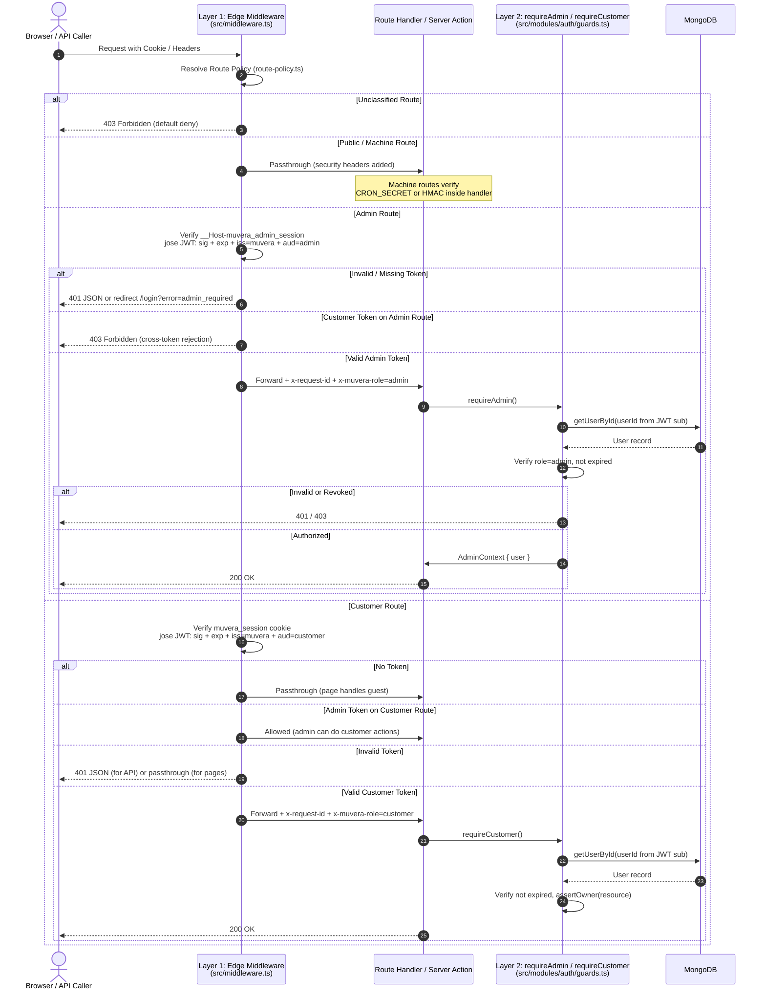

# MUVERA Authentication Architecture

## Overview

MUVERA uses a two-layer, default-deny authentication architecture. Every request passes through both layers before being served.

---

## Request Flow Diagram



---

## Route Policy Table

| Route Pattern | Class | Layer 1 Verification | Layer 2 Guard |
|:---|:---:|:---|:---|
| `/_next/*`, `/favicon`, `/icon`, `/manifest`, `/robots.txt`, `/sitemap.xml` | `public` | Passthrough | None |
| `/api/cron/*` | `machine` | Passthrough | Constant-time `CRON_SECRET` in handler |
| `/api/webhooks/razorpay` | `machine` | Passthrough | HMAC-SHA256 signature in handler |
| `/api/webhooks/brevo` | `machine` | Passthrough | Webhook key in handler |
| `/api/seed` | `machine` | Passthrough | Dev/test only |
| `/api/admin/*` | `admin` | `aud=admin` JWT via `ADMIN_SESSION_SECRET` | `requireAdmin()` |
| `/api/orders` (GET all, PATCH) | `admin` | `aud=admin` JWT | `requireAdmin()` |
| `/api/orders` (POST) | `public` | None | None (guest checkout) |
| `/api/orders?id=` (GET single) | `customer` | Passthrough | Ownership check inside handler |
| `/api/returns` (GET, PATCH) | `admin` | `aud=admin` JWT | `requireAdmin()` |
| `/api/returns` (POST) | `customer` | `aud=customer` JWT | `requireCustomer()` |
| `/api/settings` (GET) | `public` | Passthrough | None |
| `/api/settings` (PUT/POST) | `admin` | `aud=admin` JWT | `requireAdmin()` |
| `/api/inventory` | `public` | Passthrough | Read-only public |
| `/api/categories`, `/api/products`, `/api/coupons` | `public` | Passthrough | None |
| `/admin/*` | `admin` | `aud=admin` JWT | Admin layout `requireAdminOrRedirect()` |
| `/cart`, `/checkout`, `/wishlist` | `customer` | `aud=customer` JWT (soft) | Layer 2 inside page |
| `/order-success/*` | `customer` | `aud=customer` JWT (soft) | Ownership validation |
| `/account/*` | `customer` | `aud=customer` JWT (soft) | `requireCustomer()` + ownership |
| `/`, `/products/*`, `/product/*`, `/categories`, `/search` | `public` | Passthrough | None |
| `/login`, `/signup`, `/forgot-password`, `/reset-password` | `public` | Passthrough | Redirect if already authed |
| `/dev/*` | `public` | Passthrough | Dev tools |
| **Unclassified** | **default-deny** | **403 Forbidden** | — |

---

## Cookie Architecture

| Cookie | Role | SameSite | Secure | HttpOnly | Max-Age |
|:---|:---:|:---:|:---:|:---:|:---:|
| `muvera_admin_session` | Admin | `Strict` | `true` (prod) | `true` | 6 hours |
| `muvera_session` | Customer | `Lax` | `true` (prod) | `true` | 6 hours |

- **Admin cookie** uses `SameSite=Strict` to prevent CSRF on sensitive admin mutations.
- **Customer cookie** uses `SameSite=Lax` to allow WhatsApp/OAuth redirects.
- On login, only the appropriate cookie is set; the other is cleared.
- On logout, both cookies are cleared.

---

## JWT Format

All session tokens are compact JWTs (HS256) with the following claims:

```json
{
  "sub": "user_123",
  "email": "user@example.com",
  "name": "Display Name",
  "role": "customer",
  "aud": "customer",
  "iss": "muvera",
  "iat": 1729000000,
  "exp": 1729021600
}
```

- `aud` (audience): `"admin"` or `"customer"` — strictly enforced at Layer 1 and Layer 2.
- `iss` (issuer): always `"muvera"` — verified at both layers.
- **Admin tokens** are signed with `ADMIN_SESSION_SECRET`.
- **Customer tokens** are signed with `SESSION_SECRET`.
- Cross-audience tokens are rejected immediately at the Edge.

---

## Security Headers (applied to every response)

| Header | Value |
|:---|:---|
| `X-Content-Type-Options` | `nosniff` |
| `X-Frame-Options` | `DENY` |
| `Referrer-Policy` | `strict-origin-when-cross-origin` |
| `X-DNS-Prefetch-Control` | `off` |
| `Permissions-Policy` | `camera=(), microphone=(), geolocation=(), payment=(self)` |
| `x-request-id` | Unique UUID per request (for distributed tracing) |

---

## Layer 2 Guards Reference

```typescript
// Require authenticated admin — throws 401/403 if not
const { user } = await requireAdmin();

// Require authenticated customer — throws 401 if not
const ctx = await requireCustomer();

// Enforce resource ownership (throws 403 if not owner and not admin)
ctx.assertOwner(order.customerEmail);
ctx.assertOwnerByPhone(order.customerPhone);

// Optional — returns null if unauthenticated, no throw
const user = await getOptionalUser();

// For Server Components (redirects instead of throwing)
const { user } = await requireAdminOrRedirect();
```

---

## CI Route Classification Check

Run `npm run check:routes` to verify all discovered routes are classified:

```
✅ All 32 route(s) are classified in src/config/route-policy.ts
```

Add to your CI pipeline to prevent unreviewed routes from being deployed.

---

## Environment Variables

| Variable | Purpose | Default (dev) |
|:---|:---|:---|
| `SESSION_SECRET` | HMAC key for customer JWT signing | `muvera_customer_session_secret_2026` |
| `ADMIN_SESSION_SECRET` | HMAC key for admin JWT signing | `muvera_admin_session_jwt_secret_2026` |
| `ADMIN_SECRET_KEY` | Legacy shared secret | `muvera_admin_master_secret_2026` |
| `CRON_SECRET` | Machine route Bearer token | `muvera_cron_secret_internal_2026` |

> **Production requirement**: Set all secrets to cryptographically random values of at least 32 bytes in your production environment. Never use the defaults in production.
