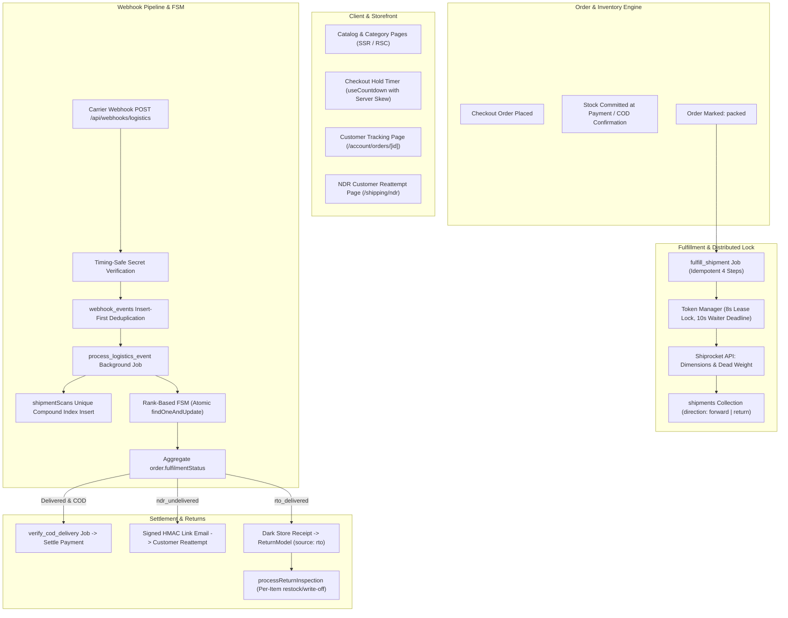

# MUVERA Logistics & Shiprocket Integration Architecture

This document provides the definitive technical specification and operational reference for MUVERA's logistics engine, Shiprocket integration, and client performance optimizations.

---

## 1. High-Level System Architecture

---

## 2. Core Architectural Guarantees

1. **Zero Secret Fallbacks in Production**:
   - Webhook authentication requires `LOGISTICS_WEBHOOK_SECRET` ($\ge 32$ chars).
   - Tokens encrypted at rest using AES-256-GCM (`TOKEN_ENCRYPTION_KEY`).
   - Missing provider secrets in production fail startup explicitly without silent mock fallback.
2. **Atomic Ingestion & Duplicate Protection**:
   - `webhook_events` uses a deterministic compound unique index: `{ source: 1, eventKey: 1 }`.
   - Incoming webhook returns HTTP 200 immediately, deferring processing to `process_logistics_event`.
   - `shipmentScans` uses a unique compound index: `{ awb: 1, timestamp: 1, status: 1, location: 1 }` to prevent scan duplication from repetitive payloads.
3. **Rank-Based Finite State Machine**:
   - `pickup_exception` is ranked at 1 (equal to `manifested`), and `ndr_undelivered` at 4 (equal to `out_for_delivery`), permitting forward jumps without stranding parcels.
   - `SHIPPED` maps to `picked_up`.
   - `DELAYED` and `RTO ACKNOWLEDGED` are informational scans that update location while leaving shipment status unchanged.
   - `rto_delivered` terminates forward shipment tracking; dark store receipt generates a `ReturnModel` record with `source: 'rto'` for per-unit inspection.
4. **Resilient Token Management**:
   - 8-second lease lock on `system_locks` catching Mongo error `11000` as lock busy.
   - 10-second waiter deadline polling `system_settings` for freshly refreshed tokens.
   - 5-second login request timeout.
   - 60-second negative cache strictly for 4xx credential failures.
   - 401 double-check: if stored token differs from rejected token, retries immediately without locking.
5. **Secure NDR Reattempt**:
   - Per-attempt signed HMAC link (`shipmentId:awb:attempt:exp`).
   - Constant-time verification with buffer length guard before `crypto.timingSafeEqual`.
   - Atomically consumed via `$addToSet: { 'ndr.usedAttempts': attempt }`.
   - Storefront form sets `<meta name="referrer" content="no-referrer">` and restricts edits to date, alternate contact, and landmark instructions.
6. **Strict COD Remittance**:
   - Decimal string parser strips currency symbols and commas, validating `/^-?\d+(\.\d{1,2})?$/`.
   - Dry-run preview calculates gross, fees, net, and detects unmatchable AWBs.
   - Commit enforces file hash check, unique `crfId`, and records an audit log.
7. **Client Performance & SSR**:
   - Catalog and category routes remain Server Components (RSC) with `revalidateTag('catalog')`.
   - `useCountdown` hook renders neutral pre-mount state (`isMounted: false`, `isExpired: false`, `hasTarget`), dynamically tracking clock skew without global Redux re-renders.
